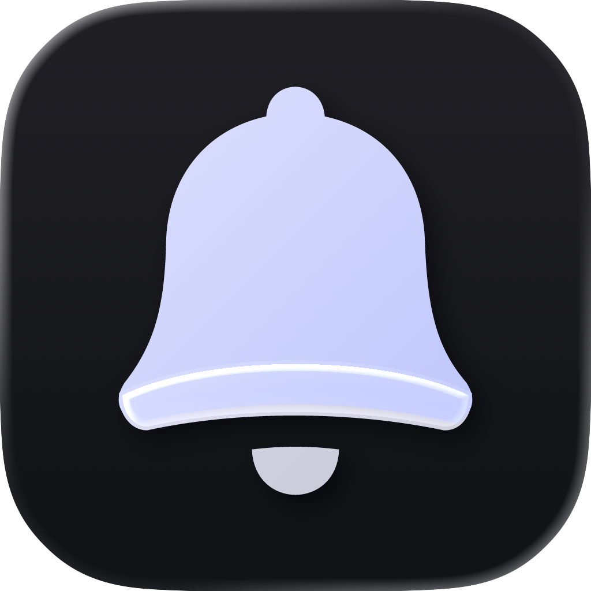

<div align="center">



# Journal

Дневник студента МГТЭК: расписание, отметки, пропуски и задания.<br>
Android и iOS. Без рекламы и аккаунтов, работает офлайн.

[](https://github.com/eugggeneee/journal/releases/latest)
[](https://github.com/eugggeneee/journal/releases?q=beta&expanded=true)
[](https://github.com/eugggeneee/journal/actions/workflows/ci.yml)
[](LICENSE)

</div>

> [!NOTE]
> Неофициальное приложение. Расписание берётся с общедоступной страницы сайта колледжа и может отличаться от актуального.

## Возможности

- **Главная.** В верхней карточке видны текущая пара, крупный отсчёт до звонка, ход дня и три показателя журнала. Ниже расположены действия текущей пары и следующая пара. Блоки можно скрывать и переставлять. Во время пары здесь можно поставить отметку, отметить пропуск и записать свою пометку. Нажатие на номер в «Ходе дня» открывает пару.
- **Расписание.** Неделя листается свайпом. Часы идут по вертикали, занятия занимают своё время в сетке. Карточки чередуют два близких нейтральных тона при смене предмета. Одинаковые пары подряд сохраняют одну заливку. На телефоне виден один день, на широком экране можно сопоставить семь дней по одной шкале. В меню выбранной даты можно отметить весь день или изменить звонки. На карточке видны предметы подгрупп, кабинеты, преподаватели, пометки, пропуск, задания и сроки. Загруженные дни открываются без интернета.
- **Отметки.** Шкала 1-10, предмет, тип работы, заметка. Средний балл и динамика по предметам, цель по предмету и прогноз: сколько нужно получить, чтобы дотянуть.
- **Пропуски.** Отметка у пары или на весь день, уважительная причина, лимиты 10 часов в месяц и 72 часа в семестр с предупреждениями заранее, календарь месяца с тепловой картой.
- **Задания.** Домашнее задание и заметки к парам со сроком, отметка «сделано», напоминание на главной.
- **Оформление.** Material 3, светлая и тёмная темы, 20 цветовых тем со своим значком, цвета обоев на Android 12+, настраиваемые анимации.
- **Данные.** Отмена любого действия, резервная копия в файл .json или через буфер обмена.

При первом запуске выберите группу и подтвердите звонки для будней, субботы и сокращённого дня. Каждый профиль можно выбрать из шаблонов или настроить вручную.

## Установка

Файлы лежат в [Releases](https://github.com/eugggeneee/journal/releases/latest).

| Платформа | Файл | Как установить |
|---|---|---|
| Android | `Journal-vX.Y.Z-android.apk` | Открыть файл, разрешить установку из этого источника |
| iPhone, iPad | Источник Journal | [Добавить в AltStore Classic или SideStore](https://eugggeneee.github.io/journal/ios/), затем установить Journal из каталога |
| iPhone, iPad | Файл IPA | [Скачать IPA](https://eugggeneee.github.io/journal/ios/#ipa) и выбрать файл в **My Apps → +** в AltStore Classic или SideStore. На компьютере можно использовать [Sideloadly](https://sideloadly.io) |

**На iPhone начните с AltStore Classic.** Установите магазин с помощью AltServer на компьютере, затем добавьте источник один раз. Новая стабильная версия появится в **My Apps → Update**. С бесплатной учётной записью Apple подпись действует семь дней, для продления устройству нужен доступ к AltServer. [Скачать AltServer](https://altstore.io/download)

| Как установить | Что сделать |
|---|---|
| Предварительные версии | В [GitHub Releases](https://github.com/eugggeneee/journal/releases?q=beta) откройте нужный pre-release и скачайте APK или IPA из **Assets**. |
| SideStore на iOS | Пройдите первоначальную настройку, затем добавьте источник по ссылке выше. SideStore умеет продлевать подпись на устройстве через локальное VPN-подключение. [Инструкция SideStore](https://docs.sidestore.io/docs/installation/install.html) |
| IPA через компьютер | Скачайте IPA из [стабильного выпуска](https://github.com/eugggeneee/journal/releases/latest), подключите iPhone и перетащите файл в Sideloadly. Поддерживаются Windows, macOS и бесплатная учётная запись Apple. [Sideloadly](https://sideloadly.io/) |
| Обновления Android через Obtainium | [Откройте Journal в Obtainium](https://apps.obtainium.imranr.dev/redirect?r=obtainium%3A%2F%2Fadd%2Fhttps%3A%2F%2Fgithub.com%2Feugggeneee%2Fjournal) или вставьте адрес репозитория в **Add App**, выберите APK и оставьте приём предварительных версий выключенным для стабильного канала. [Официальный Obtainium](https://github.com/ImranR98/Obtainium) |

Для ручного добавления в **Sources → +** используйте [стабильный источник Journal](https://eugggeneee.github.io/journal/ios/stable.json).

<details>
<summary>Проверка файла</summary>

```bash
sha256sum -c SHA256SUMS.txt
gh attestation verify Journal-vX.Y.Z-android.apk --repo eugggeneee/journal
```

</details>

## Скриншоты интерфейса

<picture>
  <source media="(prefers-color-scheme: dark)" srcset="https://eugggeneee.github.io/journal/ios/media/header-dark.jpg">
  
</picture>

[Стабильная галерея](https://github.com/eugggeneee/journal/tree/screenshots/pack/stable) и [галерея последней снятой беты](https://github.com/eugggeneee/journal/tree/screenshots/pack/beta) содержат одинаковые экраны iPhone в двух режимах оформления и главную во всех 20 цветовых темах. Для каждого кадра доступны светлый и тёмный корпус на прозрачном фоне. [Фирменные макеты Journal](https://github.com/eugggeneee/journal/tree/screenshots/pack/stable/mockups) и [обе рамки PNG](https://github.com/eugggeneee/journal/tree/screenshots/pack/stable/frames) можно скачать отдельно. Каждый из четырёх макетов доступен в светлой и тёмной теме. На бета-макетах рядом с Journal стоит плашка «бета». На каждом снимке вымышленные данные группы 0000. [Скачать ZIP с исходниками и рамками](https://github.com/eugggeneee/journal/archive/refs/heads/screenshots.zip). [Как собрать новый пак](docs/screenshots/README.md)

## Конфиденциальность

- Отметки, пропуски и настройки хранятся только на устройстве.
- Расписание загружается с сайта колледжа. Для проверки обновлений приложение запрашивает последний стабильный релиз на GitHub. Номер установленной версии виден в настройках.
- Нет аккаунтов, рекламы и аналитики.

## Вопросы

<details>
<summary>Нужен ли интернет?</summary>

Для загрузки расписания и проверки обновлений. Уже загруженные дни, отметки и пропуски доступны без сети.

</details>

<details>
<summary>Почему расписание может отличаться от актуального?</summary>

Приложение читает общедоступную страницу сайта колледжа и не является официальным. Если колледж изменил расписание после загрузки, данные в приложении устареют.

</details>

<details>
<summary>Почему на iPhone приложение нужно переподписывать?</summary>

С бесплатным Apple ID подпись действует 7 дней. Магазин может продлевать её в фоне. Если фоновое продление пропущено, нажмите **Refresh** в **My Apps** до истечения подписи. AltStore Classic для этого нужен доступ к AltServer.

</details>

<details>
<summary>Как не потерять данные при смене телефона?</summary>

Перед переездом сделайте резервную копию через буфер обмена: данные хранятся только на устройстве.

</details>

## Разработка

Нужны Flutter 3.47 или новее и Python 3.10 или новее.

```bash
flutter create --platforms=android,ios --org eugggeneee --project-name journal .
flutter pub get
flutter analyze
flutter test
python3 scripts/project/check.py
flutter run
```

Папки `android/` и `ios/` не хранятся в репозитории: их создаёт `flutter create`. Идентификатор приложения: `eugggeneee.journal`. Перед коммитом выполните `python3 scripts/project/check.py`.

| Документ | Содержание |
|---|---|
| [CONTRIBUTING.md](CONTRIBUTING.md) | Порядок работы и проверки перед коммитом |
| [docs/ARCHITECTURE.md](docs/ARCHITECTURE.md) | Структура проекта, слои, данные |
| [docs/STYLE.md](docs/STYLE.md) | Правила кода и интерфейса |
| [docs/COMMITS.md](docs/COMMITS.md) | Формат коммитов |
| [docs/VERSIONING.md](docs/VERSIONING.md) | Нумерация версий |
| [docs/RELEASING.md](docs/RELEASING.md) | Выпуск релиза и ключ подписи |
| [docs/PRERELEASES.md](docs/PRERELEASES.md) | Тестовые версии |
| [docs/TESTING.md](docs/TESTING.md) | Автоматические и ручные проверки |
| [SECURITY.md](SECURITY.md) | Сообщения об уязвимостях |
| [CHANGELOG.md](CHANGELOG.md) | История изменений |

<div align="center"><sub>Лицензия <a href="LICENSE">MIT</a></sub></div>
