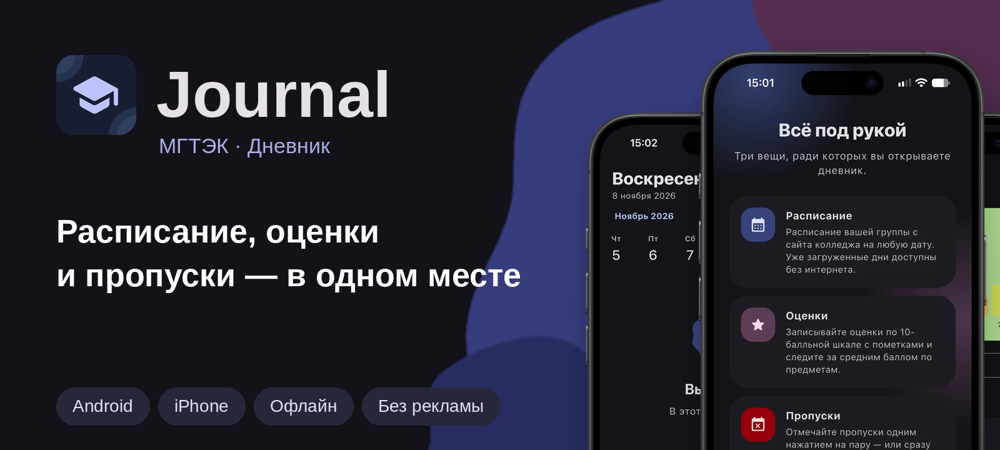

<div align="center">



<br><br>

<a href="https://github.com/eugggeneee/journal/releases/latest"></a>
&nbsp;
<a href="https://github.com/eugggeneee/journal/releases/latest"></a>

</div>

# Journal

Дневник студента МГТЭК: расписание группы, оценки и пропуски. Android и iOS. Бесплатно, без рекламы, без аккаунтов, работает офлайн. Лицензия MIT.

Неофициальное приложение. Расписание берётся с общедоступной страницы сайта колледжа и может отличаться от актуального.

## Возможности

Расписание
- Пары группы на любую дату; загруженные дни доступны без интернета.
- Время пар: готовые расписания колледжа или ручной ввод (пары 1-7, суббота отдельно). В карточке пары показаны начало, конец, перерыв внутри пары и обед.
- Пометки ОКР, Зачёт, Практика, Сокращённый день или своя: на пару или на весь день, на любую дату.

Оценки
- Шкала 1-10, предмет из расписания дня, тип работы и заметка.
- Средний балл, распределение, динамика по предметам.

Пропуски
- Отметка у пары одним касанием или на весь день; 1 или 2 часа; уважительная причина.
- Лимиты без уважительной причины: 10 часов в месяц и 72 часа в семестр, предупреждения с 7 и 62 часов.

Прочее
- Material 3, светлая и тёмная темы, 20 цветовых тем, цвета обоев на Android 12+.
- Смена значка приложения под тему на Android и iOS.
- Отмена любого действия, резервная копия через буфер обмена, виброотклик.

## Установка

Файлы лежат в [Releases](https://github.com/eugggeneee/journal/releases/latest).

| Платформа | Файл | Как установить |
|---|---|---|
| Android | `Journal-vX.Y.Z-android.apk` | Открыть файл, разрешить установку из этого источника |
| iPhone, iPad | `Journal-vX.Y.Z-ios.ipa` | Установить через [AltStore](https://altstore.io) или [Sideloadly](https://sideloadly.io) |

Сборка для iOS не подписана Apple. С бесплатным Apple ID её нужно переподписывать раз в 7 дней; AltStore делает это автоматически.

Проверка файла:

```bash
sha256sum -c SHA256SUMS.txt
gh attestation verify Journal-vX.Y.Z-android.apk --repo eugggeneee/journal
```

## Конфиденциальность

- Оценки, пропуски и настройки хранятся только на устройстве.
- Единственный сетевой запрос: загрузка расписания с сайта колледжа.
- Нет аккаунтов, рекламы и аналитики.

## Разработка

Требования: Flutter 3.47 или новее, Python 3.10 или новее (скрипты проекта).

```bash
flutter create --platforms=android,ios --org eugggeneee --project-name journal .
flutter pub get
flutter analyze
flutter test
python3 scripts/project/check.py
flutter run
```

Папки `android/` и `ios/` не хранятся в репозитории: их создаёт `flutter create`. Идентификатор приложения: `eugggeneee.journal`.

Перед коммитом выполните `python3 scripts/project/check.py` и, если менялись файлы в `lib/` или `test/`, `python3 scripts/project/graph.py`.

## Документация

| Документ | Содержание |
|---|---|
| [CONTRIBUTING.md](CONTRIBUTING.md) | Порядок работы и проверки перед коммитом |
| [docs/ARCHITECTURE.md](docs/ARCHITECTURE.md) | Структура проекта, слои, данные |
| [docs/GRAPH.md](docs/GRAPH.md) | Граф зависимостей (генерируется) |
| [docs/STYLE.md](docs/STYLE.md) | Правила кода и интерфейса |
| [docs/COMMITS.md](docs/COMMITS.md) | Формат коммитов |
| [docs/VERSIONING.md](docs/VERSIONING.md) | Нумерация версий |
| [docs/RELEASING.md](docs/RELEASING.md) | Выпуск релиза и ключ подписи |
| [docs/PRERELEASES.md](docs/PRERELEASES.md) | Тестовые версии |
| [docs/TESTING.md](docs/TESTING.md) | Автоматические и ручные проверки |
| [SECURITY.md](SECURITY.md) | Сообщения об уязвимостях |
| [CHANGELOG.md](CHANGELOG.md) | История изменений |

## Лицензия

[MIT](LICENSE)
