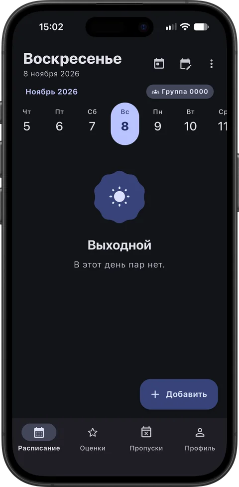
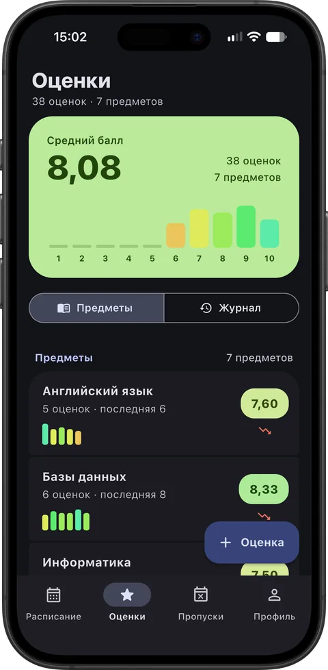
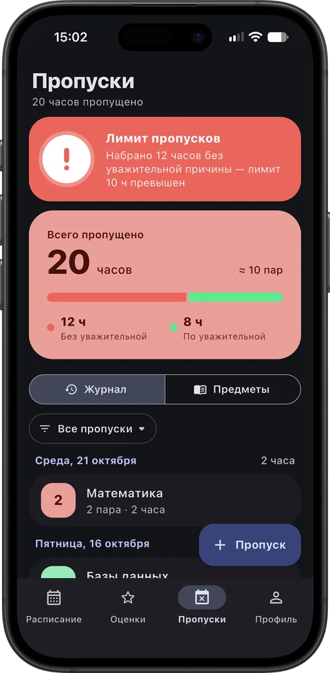
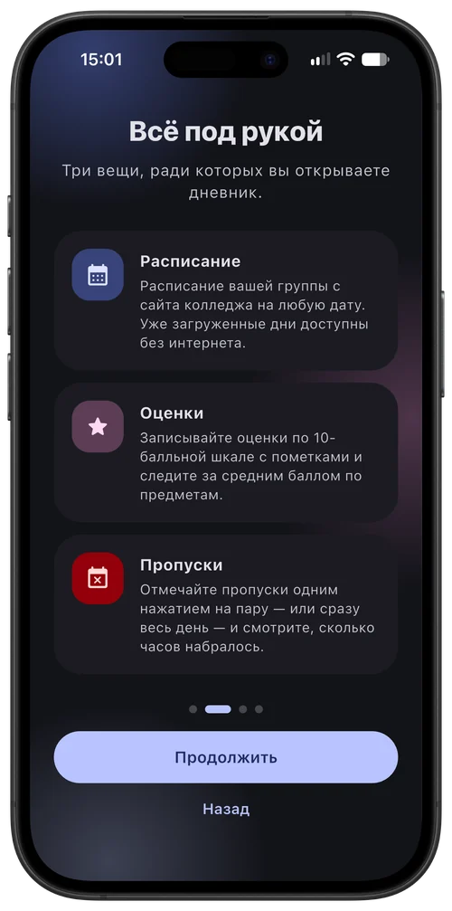

  

&nbsp;

&nbsp;

<a href="#что-умеет">Возможности</a> &nbsp;·&nbsp;
<a href="#установка">Установка</a> &nbsp;·&nbsp;
<a href="#конфиденциальность">Конфиденциальность</a> &nbsp;·&nbsp;
<a href="RELEASING.md">Сборка</a>

 

 

<table>
<tr>
<td></td>
<td></td>
<td></td>
<td></td>
</tr>
<tr align="center">
<td><b>Расписание</b></td>
<td><b>Оценки</b></td>
<td><b>Пропуски</b></td>
<td><b>Всё под рукой</b></td>
</tr>
</table>

 

## О проекте

**Journal** — дневник для студентов **МГТЭК**. Показывает расписание вашей группы, помогает вести оценки и отмечать пропуски. Быстро, просто и работает даже без интернета.

Проект **некоммерческий**: бесплатный, без рекламы и без аккаунтов. Его сделал учащийся колледжа для себя и одногруппников.

## Что умеет

### 📅 Расписание
- Пары вашей группы на любую дату
- Уже загруженные дни доступны без интернета
- Автообновление при запуске и обновление вручную
- Быстрая смена группы с поиском по списку

### 🎯 Оценки
- Ввод оценки от 1 до 10 с клавиатуры в одно касание
- Предмет выбирается из расписания выбранного дня
- Дата: сегодня, вчера или любая другая
- Тип работы и заметка к оценке
- «Ещё одну» — быстрый ввод серии оценок
- Средний балл и распределение оценок по каждому предмету
- Свайп влево — удалить оценку

### 🕘 Пропуски
- Отметка пропуска у нужной пары — одним касанием
- «Весь день» — отметить все пары сразу
- Можно выбрать несколько пар, 1 или 2 часа
- Пометка «по уважительной причине» (справка, болезнь, заявление)
- Свайп вправо — сменить причину, влево — удалить
- С 7 часов без уважительной — счётчик до лимита в 10 часов, с 10 — яркая карточка с «!» (по уважительной не считаются)

### ✨ Удобство
- Выбор группы, предмета, цвета темы, значка и часов по умолчанию — красивые нижние шторки Material 3
- Любое действие отменяется кнопкой «Отменить» — подтверждения не мешают
- Резервная копия оценок и пропусков: сохранение в буфер обмена и восстановление
- Светлая и тёмная темы и 20 цветовых тем Material Design (стандартная, чёрно-белая и все основные цвета); на Android 12+ по умолчанию цвета подстраиваются под обои
- Значок приложения под каждую тему — меняется в настройках на Android и iPhone
- Интерфейс не «прыгает»: пропуски, оценки и числа появляются плавно, без смещения соседних элементов
- Удобно на телефонах, планшетах и складных устройствах
- Виброотклик, который можно отключить

## Установка

Все готовые версии — на странице [**Releases**](../../releases/latest).

### Android

1. Скачайте файл `Journal-…-android.apk` из последнего релиза.
2. Откройте его и разрешите установку из этого источника.
3. Запускайте **Journal**.

### iPhone и iPad

Файл `Journal-…-ios.ipa` собирается без подписи Apple — его подписывает программа установки:

1. Скачайте `Journal-…-ios.ipa` из последнего релиза.
2. Установите через [AltStore](https://altstore.io) или [Sideloadly](https://sideloadly.io).

> С бесплатным Apple ID приложение нужно переподписывать раз в 7 дней — AltStore делает это автоматически.

## Конфиденциальность

- Оценки, пропуски и настройки хранятся **только на вашем устройстве**.
- Единственный сетевой запрос — загрузка расписания с общедоступной страницы сайта колледжа.
- Ни аккаунтов, ни рекламы, ни аналитики.

## Важно

Journal — **неофициальное** приложение и не является продуктом колледжа. Расписание берётся с общедоступной страницы сайта колледжа и может отличаться от актуального — сверяйтесь с официальными объявлениями.

Сборка и выпуск версий описаны в [RELEASING.md](RELEASING.md).

## Лицензия

[MIT](LICENSE)

 

**Journal** · МГТЭК · Дневник

