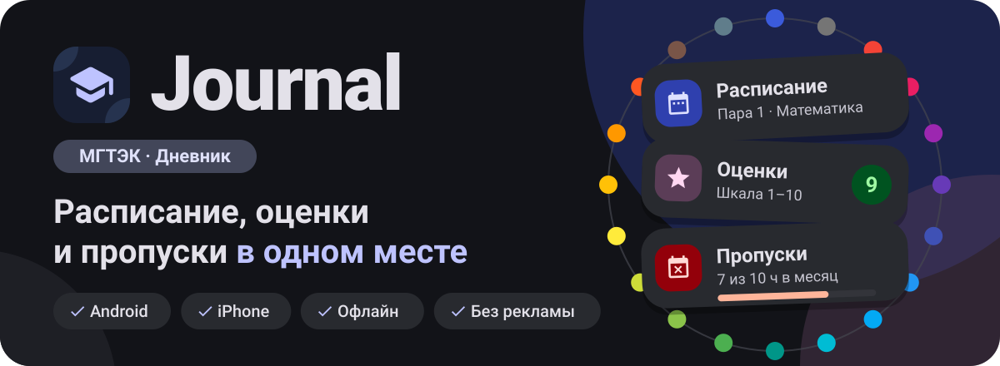
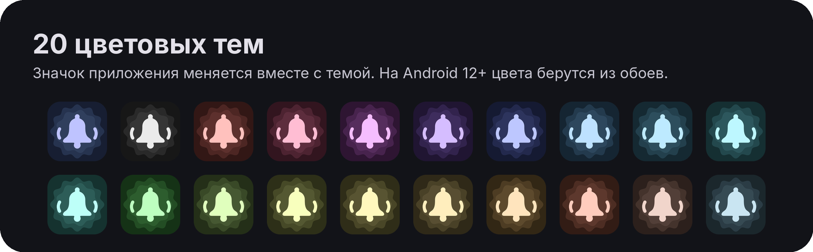

<div align="center">



[](https://github.com/eugggeneee/journal/releases/latest)
[](https://github.com/eugggeneee/journal/actions/workflows/ci.yml)
[](LICENSE)


[**Скачать**](https://github.com/eugggeneee/journal/releases/latest)
&nbsp;·&nbsp;
[Возможности](#возможности)
&nbsp;·&nbsp;
[Установка](#установка)
&nbsp;·&nbsp;
[Конфиденциальность](#конфиденциальность)
&nbsp;·&nbsp;
[Разработка](#разработка)

</div>

**Journal** — дневник студента МГТЭК: расписание группы, оценки и пропуски. Приложение для Android и iOS: бесплатное, без рекламы и аккаунтов, загруженные данные доступны без интернета. Исходный код открыт под лицензией MIT.

> [!NOTE]
> Приложение неофициальное. Расписание берётся с общедоступной страницы сайта колледжа и может отличаться от актуального.

## Возможности

### Расписание

- Пары группы на любую дату. Загруженные дни доступны без интернета, ближайшие догружаются при запуске.
- Время пар: готовые расписания звонков колледжа или ручной ввод (пары 1-7, суббота отдельно). В карточке пары видны начало, конец, перерыв внутри пары и обед после неё.
- Пометки ОКР, Зачёт, Практика, Сокращённый день или своя: на пару или на весь день, на любую дату.

### Оценки

- Шкала 1-10, предмет, тип работы и заметка.
- Средний балл, распределение оценок и динамика по предметам.

### Пропуски

- Отметка у пары одним касанием или сразу на весь день: 1 или 2 часа, с уважительной причиной или без.
- Журнал пропусков и обзор по предметам.
- Лимиты часов без уважительной причины: 10 в месяц и 72 в семестр. Предупреждения появляются с 7 и с 62 часов.

### Данные и оформление

- Отмена любого действия, виброотклик.
- Резервная копия данных через буфер обмена.
- Material 3: светлая, тёмная и системная темы, 20 цветовых тем, на Android 12 и новее цвета берутся из обоев.
- Значок приложения меняется вместе с темой на Android и iOS.

<div align="center">



</div>

## Установка

Файлы приложения лежат в [Releases](https://github.com/eugggeneee/journal/releases/latest).

| Платформа    | Файл                         | Как установить                                                                           |
|--------------|------------------------------|------------------------------------------------------------------------------------------|
| Android      | `Journal-vX.Y.Z-android.apk` | Открыть файл и разрешить установку из этого источника                                    |
| iPhone, iPad | `Journal-vX.Y.Z-ios.ipa`     | Установить через [AltStore](https://altstore.io) или [Sideloadly](https://sideloadly.io) |

> [!IMPORTANT]
> Сборка для iOS не подписана Apple. С бесплатным Apple ID её нужно переподписывать раз в 7 дней; AltStore делает это автоматически.

Тестовые версии (`beta`, `rc`) публикуются как пред-релизы и не попадают в Latest.

<details>
<summary>Проверка файла</summary>

К каждому релизу прилагаются контрольные суммы и аттестация GitHub:

```bash
sha256sum -c SHA256SUMS.txt
gh attestation verify Journal-vX.Y.Z-android.apk --repo eugggeneee/journal
```

</details>

## Конфиденциальность

- Оценки, пропуски и настройки хранятся только на устройстве.
- Единственный сетевой запрос: загрузка расписания с `bseumtc.by` по HTTPS.
- Нет аккаунтов, рекламы и аналитики.

## Вопросы и ответы

<details>
<summary>Нужен ли интернет?</summary>

Только для загрузки расписания. Уже загруженные дни, оценки и пропуски доступны без сети.

</details>

<details>
<summary>Почему расписание может отличаться от актуального?</summary>

Приложение читает общедоступную страницу сайта колледжа и не является официальным. Если колледж изменил страницу или расписание после загрузки, данные в приложении устареют.

</details>

<details>
<summary>Почему на iPhone приложение нужно переподписывать?</summary>

Сборка для iOS не подписана Apple, а бесплатный Apple ID даёт подпись на 7 дней. AltStore продлевает её автоматически.

</details>

<details>
<summary>Как не потерять данные при смене телефона?</summary>

Данные хранятся только на устройстве, поэтому перед переездом сделайте резервную копию через буфер обмена.

</details>

<details>
<summary>Как считаются лимиты пропусков?</summary>

Учитываются только часы без уважительной причины. Месяц календарный: с 1-го числа счётчик начинается заново. Семестр идёт с 1 сентября до нажатия кнопки «Завершить 1-й семестр», затем до 1 августа.

</details>

## Разработка

Приложение написано на Flutter, интерфейс построен на Material 3 (пакет `material_ui`), данные хранятся локально.

Требования: Flutter 3.47 или новее, Python 3 для скриптов проекта.

```bash
flutter create --platforms=android,ios --org eugggeneee --project-name journal .
flutter pub get
flutter analyze
flutter test
python3 scripts/project/check.py
flutter run
```

Папки `android/` и `ios/` в репозитории не хранятся: их создаёт `flutter create`. Идентификатор приложения: `eugggeneee.journal`.

Перед коммитом выполните `python3 scripts/project/check.py`. Если менялись файлы в `lib/` или `test/`, выполните также `python3 scripts/project/graph.py`.

Графика README собирается командой `python3 scripts/readme/make_assets.py`. Флаг `--raster` добавляет `themes.png` и `social-preview.png`.

### Документация

| Документ                                     | Содержание                               |
|----------------------------------------------|------------------------------------------|
| [CONTRIBUTING.md](CONTRIBUTING.md)           | Порядок работы и проверки перед коммитом |
| [docs/ARCHITECTURE.md](docs/ARCHITECTURE.md) | Структура проекта, слои, данные          |
| [docs/GRAPH.md](docs/GRAPH.md)               | Граф зависимостей (генерируется)         |
| [docs/STYLE.md](docs/STYLE.md)               | Правила кода и интерфейса                |
| [docs/COMMITS.md](docs/COMMITS.md)           | Формат коммитов                          |
| [docs/VERSIONING.md](docs/VERSIONING.md)     | Нумерация версий                         |
| [docs/RELEASING.md](docs/RELEASING.md)       | Выпуск релиза и ключ подписи             |
| [docs/PRERELEASES.md](docs/PRERELEASES.md)   | Тестовые версии                          |
| [docs/TESTING.md](docs/TESTING.md)           | Автоматические и ручные проверки         |
| [SECURITY.md](SECURITY.md)                   | Сообщения об уязвимостях                 |
| [CHANGELOG.md](CHANGELOG.md)                 | История изменений                        |

## Лицензия

[MIT](LICENSE)
