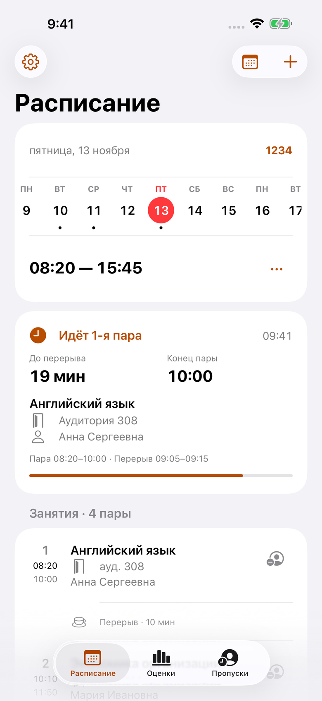
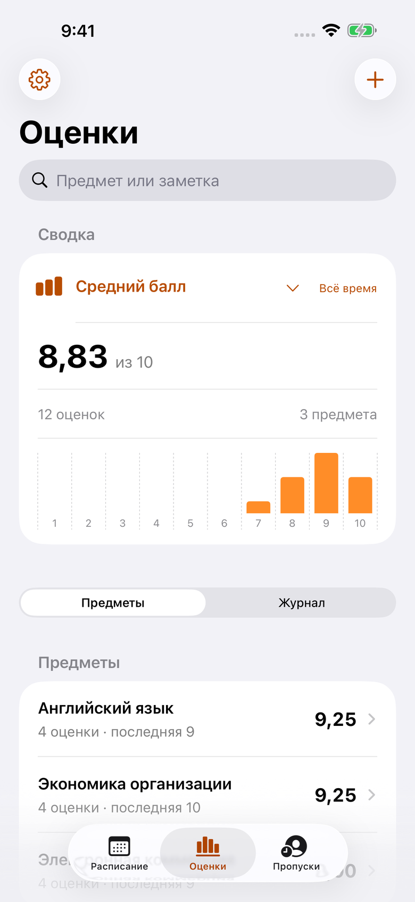

<h1 align="center">Journal</h1>

Учёба. В своём ритме.

Нативный дневник студента МГТЭК для iPhone: расписание, оценки и пропуски. Без рекламы, аккаунтов и аналитики.

- **Ваш день целиком.** Пары, кабинеты, преподаватели, пометки и время до перерыва и конца занятия.
- **Оценки под рукой.** Средний балл, прогресс по предметам и быстрый ввод нескольких оценок.
- **Пропуски без путаницы.** Уважительные и неуважительные часы, настраиваемые лимиты месяца и семестра.
- **Спокойно без сети.** Уже загруженное расписание и личные записи доступны офлайн.

Нужен **iPhone с iOS 18 или новее**. На iOS 26+ интерфейс использует системный Liquid Glass; на iOS 18 — стандартные элементы этой версии iOS. Светлая и тёмная темы следуют настройкам телефона.

  
  

Скриншоты настоящего приложения на iOS 26 с вымышленными данными.

## Установить

1. Откройте [тестовый выпуск 1.0.0-beta.2](https://github.com/eugggeneee/journal/releases/tag/v1.0.0-beta.2).
2. Скачайте **Journal.ipa** в разделе Assets нужного выпуска.
3. На iPhone откройте **AltStore Classic → My Apps → «+»** и выберите файл.
4. В Journal выберите свою группу и подходящие звонки.

Если AltStore ещё не установлен, начните с [простой инструкции](docs/INSTALL.md). Mac для скачивания готового приложения не нужен. С обычным Apple Account подпись приложения нужно регулярно обновлять через AltStore.

**Тестовая версия — `1.0.0-beta.2`.** Стабильная версия появится после проверки на настоящем iPhone. Перед установкой ознакомьтесь с ограничениями в описании выпуска.

## Не потерять данные

В **Настройки → Резервная копия** сохраните файл в «Файлы». В него входят личные записи, настройки, звонки и история расписания. Сделайте это перед удалением приложения, сменой телефона или способа подписи. Восстановление показывает состав копии перед заменой данных.

Приложение не синхронизирует записи с сервером. Интернет нужен для загрузки расписания с сайта колледжа.

## Важно знать

Journal — **неофициальное приложение**. Колледж может изменить расписание после загрузки. На сайте остаются только ближайшие дни; прошлые даты доступны, если Journal успел их сохранить.

Сокращённые звонки включаются пометкой **«Сокращённый день»** для выбранной даты. Все профили можно редактировать в настройках.

[Нашли ошибку?](https://github.com/eugggeneee/journal/issues/new/choose) Расскажите, что произошло, без личных данных и полной резервной копии.

Техническая информация и участие в проекте

Swift 6, SwiftUI, UIKit, Swift Charts. Только iPhone. Без сторонних библиотек приложения.

- [Разработка, сборка и структура](docs/DEVELOPMENT.md)
- [Правила GitHub и выпусков](docs/RELEASING.md)
- [Решения по функциям и дизайну](docs/PRODUCT.md)
- [Проверка перед стабильным выпуском](docs/TESTING.md)
- [Проверка нового дизайна](docs/DESIGN_REVIEW.md)
- [Как предложить изменение](CONTRIBUTING.md)
- [Конфиденциальность](PRIVACY.md)

Автор — **eugggeneee**. Лицензия [MIT](LICENSE).

