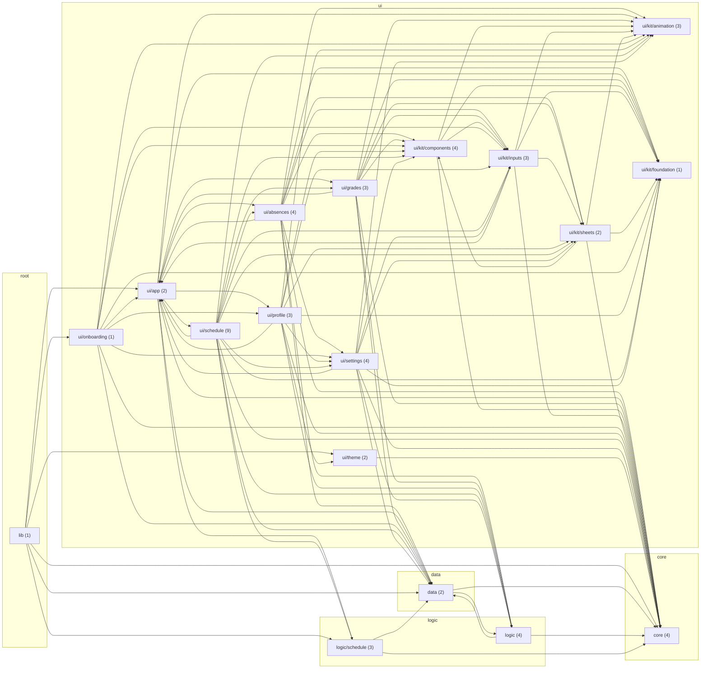

# Граф проекта

Файл создаётся скриптом `scripts/project/graph.py`. Вручную не редактируется.
После любого изменения файлов в `lib/` и `test/` (создание, перенос, удаление, смена импортов) выполните:

```bash
python3 scripts/project/graph.py
```

Файлов Dart: 55 в `lib/`, 6 в `test/`.

## Папки

Стрелка A --> B: файлы папки A импортируют файлы папки B. В скобках — число файлов.



## Правила слоёв

- core не зависит от data, logic и ui
- data не зависит от ui
- logic не зависит от ui
- ui/kit не зависит от экранов
- lib не зависит от test

## Файлы

| Файл | Строк | Импортирует | Используют |
|---|---:|---:|---:|
| `core/app_icons.dart` | 41 | 1 | 1 |
| `core/dates.dart` | 105 | 0 | 26 |
| `core/haptics.dart` | 18 | 0 | 26 |
| `core/palette.dart` | 68 | 0 | 5 |
| `data/models.dart` | 501 | 1 | 25 |
| `data/store.dart` | 399 | 5 | 19 |
| `logic/bells.dart` | 222 | 2 | 10 |
| `logic/limits.dart` | 105 | 2 | 6 |
| `logic/schedule/cp1251.dart` | 52 | 0 | 2 |
| `logic/schedule/schedule_parser.dart` | 124 | 1 | 2 |
| `logic/schedule/schedule_service.dart` | 185 | 5 | 4 |
| `logic/stats.dart` | 77 | 1 | 3 |
| `logic/subject_names.dart` | 26 | 0 | 1 |
| `main.dart` | 67 | 7 | 0 |
| `ui/absences/absence_actions.dart` | 37 | 5 | 2 |
| `ui/absences/absence_limit.dart` | 322 | 9 | 1 |
| `ui/absences/absence_sheet.dart` | 500 | 12 | 4 |
| `ui/absences/absences_page.dart` | 477 | 18 | 1 |
| `ui/app/scope.dart` | 23 | 2 | 22 |
| `ui/app/shell.dart` | 260 | 12 | 1 |
| `ui/grades/grade_sheet.dart` | 224 | 10 | 4 |
| `ui/grades/grades_page.dart` | 283 | 15 | 2 |
| `ui/grades/subject_page.dart` | 114 | 9 | 1 |
| `ui/kit/animation/motion.dart` | 45 | 0 | 18 |
| `ui/kit/animation/reveal.dart` | 278 | 1 | 21 |
| `ui/kit/animation/tab_switcher.dart` | 90 | 1 | 1 |
| `ui/kit/components/edge_fade.dart` | 74 | 0 | 8 |
| `ui/kit/components/feedback.dart` | 25 | 1 | 12 |
| `ui/kit/components/overview.dart` | 309 | 6 | 4 |
| `ui/kit/components/widgets.dart` | 487 | 6 | 22 |
| `ui/kit/foundation/ctx.dart` | 84 | 0 | 29 |
| `ui/kit/inputs/pickers.dart` | 537 | 8 | 8 |
| `ui/kit/inputs/selectors.dart` | 56 | 4 | 3 |
| `ui/kit/inputs/settings_tiles.dart` | 91 | 2 | 5 |
| `ui/kit/sheets/select_sheet.dart` | 256 | 4 | 7 |
| `ui/kit/sheets/sheet.dart` | 266 | 4 | 13 |
| `ui/onboarding/onboarding.dart` | 456 | 14 | 1 |
| `ui/profile/profile_page.dart` | 140 | 12 | 1 |
| `ui/profile/theme_page.dart` | 53 | 7 | 1 |
| `ui/profile/theme_widgets.dart` | 470 | 10 | 2 |
| `ui/schedule/day_summary.dart` | 169 | 6 | 1 |
| `ui/schedule/day_timeline.dart` | 363 | 8 | 1 |
| `ui/schedule/day_view.dart` | 233 | 18 | 1 |
| `ui/schedule/lesson_card.dart` | 165 | 10 | 2 |
| `ui/schedule/lesson_sheet.dart` | 246 | 15 | 1 |
| `ui/schedule/marks.dart` | 305 | 11 | 4 |
| `ui/schedule/now_card.dart` | 167 | 10 | 1 |
| `ui/schedule/rest_day.dart` | 122 | 7 | 1 |
| `ui/schedule/schedule_page.dart` | 364 | 11 | 1 |
| `ui/settings/bells_page.dart` | 727 | 17 | 4 |
| `ui/settings/bells_sheet.dart` | 112 | 8 | 2 |
| `ui/settings/group_picker.dart` | 261 | 6 | 4 |
| `ui/settings/settings_pages.dart` | 371 | 15 | 3 |
| `ui/theme/app_theme.dart` | 193 | 2 | 4 |
| `ui/theme/page_transitions.dart` | 36 | 0 | 1 |

## Зависимости папок

- `lib` -> `core`, `data`, `logic/schedule`, `ui/app`, `ui/onboarding`, `ui/theme`
- `core` -> нет
- `data` -> `core`, `logic`
- `logic` -> `core`, `data`
- `logic/schedule` -> `core`, `data`
- `ui/absences` -> `core`, `data`, `logic`, `ui/app`, `ui/kit/animation`, `ui/kit/components`, `ui/kit/foundation`, `ui/kit/inputs`, `ui/kit/sheets`, `ui/settings`
- `ui/app` -> `core`, `data`, `logic/schedule`, `ui/absences`, `ui/grades`, `ui/kit/animation`, `ui/kit/foundation`, `ui/profile`, `ui/schedule`
- `ui/grades` -> `core`, `data`, `logic`, `ui/app`, `ui/kit/animation`, `ui/kit/components`, `ui/kit/foundation`, `ui/kit/inputs`, `ui/kit/sheets`
- `ui/kit/animation` -> нет
- `ui/kit/components` -> `core`, `ui/kit/animation`, `ui/kit/foundation`, `ui/kit/inputs`
- `ui/kit/foundation` -> нет
- `ui/kit/inputs` -> `core`, `ui/app`, `ui/kit/animation`, `ui/kit/foundation`, `ui/kit/sheets`
- `ui/kit/sheets` -> `core`, `ui/kit/animation`, `ui/kit/components`, `ui/kit/foundation`
- `ui/onboarding` -> `core`, `data`, `ui/app`, `ui/kit/animation`, `ui/kit/components`, `ui/kit/foundation`, `ui/kit/inputs`, `ui/profile`, `ui/settings`
- `ui/profile` -> `core`, `logic`, `ui/app`, `ui/kit/animation`, `ui/kit/components`, `ui/kit/foundation`, `ui/kit/inputs`, `ui/kit/sheets`, `ui/settings`, `ui/theme`
- `ui/schedule` -> `core`, `data`, `logic`, `logic/schedule`, `ui/absences`, `ui/app`, `ui/grades`, `ui/kit/animation`, `ui/kit/components`, `ui/kit/foundation`, `ui/kit/inputs`, `ui/kit/sheets`, `ui/settings`
- `ui/settings` -> `core`, `data`, `logic`, `ui/app`, `ui/kit/animation`, `ui/kit/components`, `ui/kit/foundation`, `ui/kit/inputs`, `ui/kit/sheets`
- `ui/theme` -> `core`

## Тесты

| Тест | Проверяет |
|---|---|
| `data/settings_test.dart` | `core/palette.dart`, `data/models.dart` |
| `data/store_test.dart` | `data/models.dart`, `data/store.dart`, `logic/stats.dart` |
| `logic/bells_test.dart` | `data/models.dart`, `data/store.dart`, `logic/bells.dart` |
| `logic/limits_test.dart` | `data/models.dart`, `logic/limits.dart` |
| `logic/parser_test.dart` | `core/dates.dart`, `logic/schedule/cp1251.dart`, `logic/schedule/schedule_parser.dart`, `logic/schedule/schedule_service.dart` |
| `project/version_test.dart` | файлы проекта |
